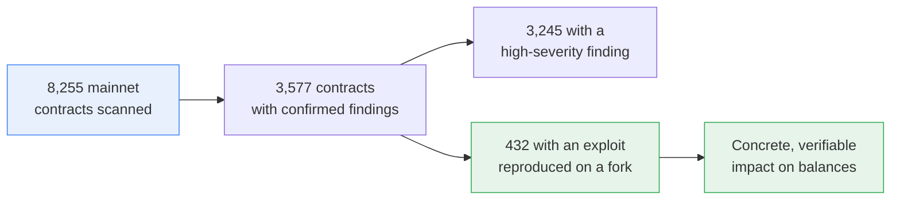
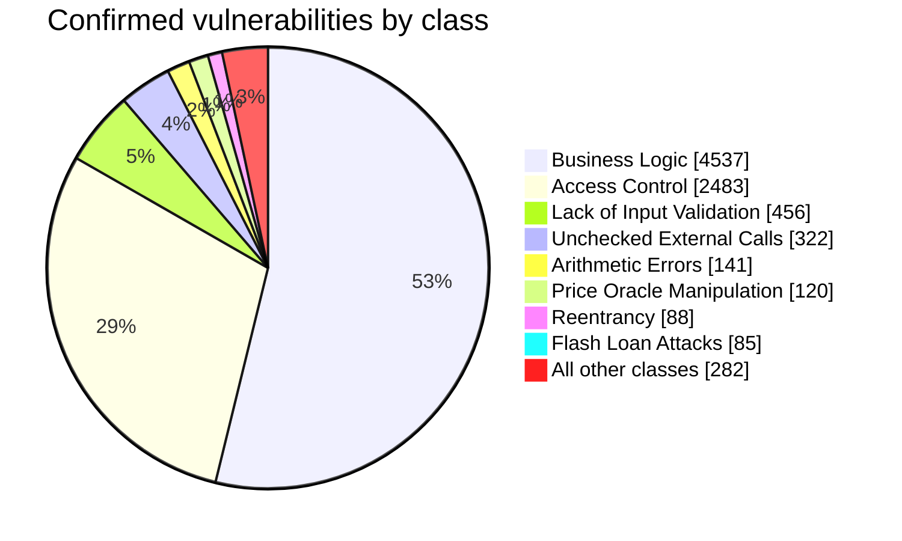

# Scanning 8,255 On-Chain Contracts

### What an autonomous audit system found on Ethereum mainnet

| | |
| --- | --- |
| **Coverage** | 8,255 unique Ethereum mainnet contracts |
| **Findings** | 6,466 confirmed vulnerabilities |
| **Reproduced exploits** | 434 exploitation scenarios executed against mainnet forks |
| **Vulnerability classes** | All 10 priority classes reached |
| **Period** | July – September 2026 |

> **Handling note.** This document describes unpatched vulnerabilities in live contracts.
> Contract addresses are shown as truncated prefixes (`0x1a2b3c…`) so that findings can be
> referenced and cross-checked without publishing a complete exploitation target. Full addresses
> and reproduction scripts are available to affected parties and to customers under disclosure
> terms. Treat this document as confidential until the findings have been disclosed responsibly.

---

## 1. Summary

We scanned 8,255 distinct contracts deployed on Ethereum mainnet and confirmed **6,466
vulnerabilities**. The scan was fully autonomous: every contract was analysed without human
direction, and the system is required to cite concrete supporting evidence from the contract's
own audit before any claim is reported as a confirmed finding.

| Result | Count | Share |
| --- | ---: | ---: |
| Contracts scanned | 8,255 | — |
| Contracts with at least one confirmed vulnerability | **3,577** | **43.7%** |
| Contracts with a high-severity vulnerability | **3,245** | **39.6%** |
| Contracts where an exploit was reproduced on a forked mainnet | **432** | **5.3%** |
| Total confirmed vulnerabilities | **6,466** | — |

The most important number is not the detection rate. It is this: **for 432 contracts we did not
merely suspect a problem — we demonstrated it**, by replaying the attack against a fork of
mainnet state and observing the concrete effect on balances. That is the difference between an
automated scanner that produces plausible warnings and a system that produces evidence.

---

## 2. What was found

Vulnerability classes are sharply concentrated, and the mix is characteristic of real DeFi
periphery rather than toy contracts.

| Vulnerability class | Confirmed | Share | Contracts affected |
| --- | ---: | ---: | ---: |
| Business Logic | 4,537 | 70.2% | 3,040 |
| Access Control | 2,483 | 38.4% | 2,156 |
| Lack of Input Validation | 456 | 7.0% | 418 |
| Unchecked External Calls | 322 | 5.0% | 310 |
| Arithmetic Errors | 141 | 2.2% | 130 |
| Price Oracle Manipulation | 120 | 1.9% | 116 |
| Reentrancy | 88 | 1.4% | 87 |
| Flash Loan-Facilitated Attacks | 85 | 1.3% | 83 |
| Centralization / Privileged Roles | 71 | 1.1% | 71 |
| Proxy & Upgradeability | 36 | 0.6% | 36 |
| Denial of Service / Griefing | 34 | 0.5% | 32 |
| Funds Locked / Unwithdrawable | 24 | 0.4% | 21 |
| Integer Overflow / Underflow | 17 | 0.3% | 17 |
| Signature / Replay | 12 | 0.2% | 12 |
| Front-running / MEV | 10 | 0.1% | 10 |
| Precision / Rounding | 6 | 0.1% | 6 |
| Weak Randomness | 5 | 0.1% | 5 |
| Missing Events | 4 | 0.1% | 4 |
| Tokenomics / Design Risk | 3 | 0.0% | 3 |
| Other | 60 | 0.9% | 58 |

Every one of the ten vulnerability classes the system is instructed to prioritise was found in
the wild — from access control and business logic at the top of the list down to weak randomness
and integer overflow at the bottom. A scanner that only ever reported one or two classes would
be pattern-matching; this distribution reflects genuine breadth.

---

## 3. Proof: what the system actually caught

The findings below are reproduced from the scan output. Each one is a real contract, a concrete
mechanism, and a measurable impact.

### 3.1 An unauthenticated function that drains the contract to a hardcoded address

**The contract** `0xD7b761…` exposes a single state-changing entry point, `flashloan()`, marked
payable and callable by anyone. There is no authorisation, no whitelist, no fee check, and no
repayment requirement.

**The mechanism.** The function reads a hardcoded recipient address (`0x6a20fd…`) from an internal
token contract (`0x9c82f4…`) and then transfers **its entire ETH balance** to that address — every
time it is called, by anyone.

**The impact.** At block 25,721,960 the contract held 16,742,360,800,000,000 wei. A single call
moves that balance to zero. The contract dates from July 2021 and holds ETH deposited by its
deployer, with no mechanism for depositors to recover funds.

**How it was confirmed.** The full call was executed against a fork of mainnet at that block.
The observed post-state: contract balance `0`, recipient balance increased by exactly the
contract's prior balance.

---

### 3.2 An inverted access-control check that locks out the owner and admits everyone else

**The contract** `0x9b179c…` gates all four of its privileged functions behind an ownership check.

**The mechanism.** Every check is inverted. The contract reverts when the caller **is** the
owner and succeeds for everyone else. The intended administrator is the only account in the
world that cannot use the contract.

**The impact.** Any unprivileged caller can (1) overwrite the payout wallet list, (2) drain the
entire ETH balance to wallets of their choosing, and (3) call `withdraw()`, which burns the full
balance to the zero address when no owner is set. The contract currently holds 0 ETH, so
realised loss is zero — but any ETH deposited is immediately stealable.

**How it was confirmed.** Six independent methods agreed: unit tests showed an unprivileged
account setting the wallet list and draining 10 ETH; fuzzing found a counterexample draining the
contract from 100 ETH to 999,999,991 wei; a sequence fuzz found an 8-call path draining it to
~3.19 ETH; and a property-based campaign falsified two invariants with minimised sequences.

---

### 3.3 Price-oracle manipulation enabling undercollateralised borrowing

**The contract** is a lending market, `0x53515f…`, that values sETH collateral using a
closed-source oracle at `0xdf117F…`.

**The mechanism.** The oracle's price for ETH can be refreshed by **anyone** through a
permissionless entry point, which reads a Uniswap v2 spot price from pair `0x0d4a11…`. A single
large swap moves the stored price; no time-weighting resists it.

**The impact.** On the fork, swapping roughly 500 WETH for USDT and calling the refresh moved
sETH's price **6.77×** (from 355,498,584 to 2,407,996.55 scaled units). With collateral factors
set to full value and borrowing enabled, an attacker can inflate collateral, borrow against it,
or liquidate positions for profit. Other markets sharing the same oracle are exposed identically.

**How it was confirmed.** End-to-end reproduction on a mainnet fork: enter market, mint 500 ETH,
execute the swap, call refresh, observe the 6.77× price move — then borrow against the inflated
collateral.

---

### 3.4 Free minting: a paid NFT collection that hands out tokens for 1 wei

**The contract** `0xB4E4e6…` is a collection with an advertised price of 0.07 ETH per token and a
supply cap of 10,000.

**The mechanism.** The payment check enforces only an *upper* bound — it rejects overpayment but
never requires a minimum. Worse, the fallback path reached by empty calldata or an unrecognised
function bypasses the price, access-control and supply-cap checks entirely and mints directly.

**The impact.** Any caller mints tokens for 1 wei, or for zero value from a contract. With the
supply counter forced to 10,000, the same call minted token **10,001** — the cap is not enforced
on this path. The revenue model and the advertised scarcity both fail.

**How it was confirmed.** On a forked mainnet, a 1-wei transfer with empty calldata moved
`totalSupply` from 5 to 6, minted token #6 to the sender, and incremented the contract balance by
1 wei. Setting the supply counter to 10,000 and repeating minted token #10,001.

---

### 3.5 Six million dollars of USDT locked forever

**The contract** `0xC4D8b8…` holds 6,000,000 USDT.

**The mechanism.** Its token-transfer handling requires a boolean return value from `transfer`.
USDT returns no data at all. The check therefore fails and the call reverts — so the transfer
never completes, on any path.

**The impact.** The 6,000,000 USDT is unwithdrawable — **including by the owner**. There is no
recovery path. Any future holdings of non-standard tokens are equally stuck.

**How it was confirmed.** Forked mainnet state: the owner's `withdraw(USDT)` call returns false
with empty revert data, and the contract's USDT balance remains 6,000,000 × 10⁶ afterwards.

---

### 3.6 A deployed, uninitialised contract anyone can seize

**The contract** `0xa54f70…` is live on mainnet and exposes a public `initialize` function.

**The mechanism.** At block 25,592,483 the contract's owner, fee collector, fee rate and factory
references all read as zero — it was deployed but never initialised. The initialiser is public
and unrestricted.

**The impact.** Any external account can take administrative control of a live contract address,
set itself as owner, and arbitrarily configure fees and the operational pause state. Any
integrator or user relying on that address inherits a fully compromised trust model.

**How it was confirmed.** A fork-backed reproduction in which an arbitrary address called
`initialize`, received ownership from the zero address, and then successfully invoked
`setFeeCollector`, `setFeeRate`, `pause` and `unpause` as the new owner.

---

## 4. Reproducible exploitation, not just detection

Across the corpus, **434 audit runs — covering 432 distinct contracts — produced a working
counterexample** that the system executed and observed rather than inferred.

| Demonstration evidence | Count |
| --- | ---: |
| Audit runs with an executed counterexample | 434 |
| Distinct contracts with an executed counterexample | 432 |
| Confirmed vulnerabilities inside those runs | 502 |
| Vulnerabilities carrying explicit reproduction steps | 2,229 |

These are not statistical anomalies. They are sequences of calls, executed against a fork of
mainnet at a specific block, producing a specific before-and-after state change. Each one can be
replayed independently.

Two properties make this evidence rather than assertion:

* **The state is real.** Exploits run against a fork of mainnet at a pinned block, so the
  contract's code, its balances, and every external dependency it touches are exactly as they are
  on chain.
* **The impact is observable.** A successful reproduction ends in a measured balance change —
  "contract 100 ETH → 999,999,991 wei", "16,742,360,800,000,000 wei → 0", "6.77× price move" —
  not a severity label.

---

## 5. Recurring patterns

The value of scanning at scale is that it separates one-off bugs from systemic weaknesses. These
patterns recurred across hundreds of independent contracts:

| Pattern | Vulnerabilities | Contracts affected |
| --- | ---: | ---: |
| Missing or inverted authorisation on a state-changing entry point | 1,533 | 1,362 |
| Funds locked, trapped, or with no withdrawal path | 724 | 707 |
| Owner can drain, mint, or freeze at will, with no timelock | 257 | 252 |
| Flash-loan callback not bound to its initiator | 162 | 156 |
| ERC-20 return value not checked | 159 | 158 |
| Missing payment or supply validation on mint | 94 | 92 |
| Uninitialised or publicly initialisable deployment | 38 | 35 |

*(Counts include only findings whose headline names the pattern, so they are conservative
lower bounds rather than generous estimates.)*

Several of these deserve attention precisely because they are *not* exotic:

**Missing or inverted authorisation.** By a wide margin the largest pattern, and the one with the
clearest consequences: a state-changing function that anyone can call, or an ownership check that
admits the wrong party. In its inverted form — as in case 3.2 — the legitimate administrator is
the only account locked out.

**Funds locked with no exit.** 707 contracts hold value that no one can retrieve, sometimes
including the owner. Case 3.5 is the largest single instance. Unlike a theft, this failure is
silent: nothing appears wrong until someone tries to withdraw.

**Flash-loan callbacks that trust their caller.** 156 contracts accept a flash-loan callback
without verifying who initiated the loan. The callback is a privileged execution path that
anyone can drive — a pattern that turns an otherwise well-guarded contract into an open door.

**Owner powers with no timelock.** 252 contracts give a single key the ability to drain, mint,
freeze, or reconfigure at will. This is a design decision rather than a coding error, but it is
a real risk to anyone depositing funds, and it is invisible in a code review that only looks for
attacker-reachable bugs.

**Uninitialised deployments.** 35 contracts are live and unowned, and therefore claimable by
anyone. This is a deployment-hygiene failure, not a coding error, and it is invisible unless you
check live state.

**ERC-20 return-value handling.** 158 contracts assume a boolean return that many widely-used
tokens do not provide. The result is either a silent failure or, as in case 3.5, millions of
dollars rendered permanently inaccessible.

A related theme that resists tidy counting but appears throughout the case studies is the **stale
or wrong hardcoded address** — a router, vault, or beneficiary baked in at deployment that no
longer refers to what it did when the contract was written. The source is correct; the deployed
state is not. Case 3.1 is one instance.

---

## 6. Why a bytecode-first approach matters

96.4% of the contracts scanned had **no verified source code available**. This is the normal
state of the chain, not an edge case, and it is precisely where conventional source-based
analysis stops.

The system handles this by reconstructing contract semantics from bytecode, then validating every
conclusion against live chain state and, where possible, against an executed reproduction. Three
consequences are visible in the results:

* **Deployment-state bugs become findable.** The wrong hardcoded address, the uninitialised
  contract, the locked 6,000,000 USDT — none of these exist in the source. They exist in the
  deployed state, and they only surface when you look at the deployed state.
* **Findings are confirmed against reality, not against intention.** The system checks what the
  contract actually does at a specific block, rather than what its source appears to say.
* **Coverage is not limited by verification status.** The 96.4% of the chain that is
  closed-source is addressable.

---

## 7. Conclusion

Across 8,255 Ethereum mainnet contracts, an autonomous audit system:

* confirmed **6,466 vulnerabilities**, affecting **3,577 contracts**;
* found a high-severity issue in **39.6%** of the contracts it assessed;
* **reproduced working exploits on 432 contracts**, with measured balance effects rather than
  severity estimates;
* reached **all ten** priority vulnerability classes, with a distribution consistent with real
  DeFi infrastructure;
* identified **systemic patterns** — unguarded callbacks, stale hardcoded addresses,
  uninitialised deployments, unhandled token return values — that recur across hundreds of
  independent contracts and are invisible to source-only review.

The headline is not the detection rate. It is that a meaningful fraction of what the system
reports is not a warning but a demonstration: a call sequence, run against real mainnet state,
that moves real value.

---

## Appendix — How findings are established

Every reported vulnerability is required to cite concrete supporting evidence from the audit of
that specific contract. In practice that evidence takes four forms:

| Evidence type | What it establishes |
| --- | --- |
| Executed counterexample | The exploit works against forked mainnet state, with a measured effect |
| On-chain state snapshot | The deployed contract really is in the state the finding describes |
| Bytecode reconstruction | The control flow and authority checks the finding depends on |
| Value-flow trace | Where funds actually go when the vulnerable path executes |

A claim that cannot be tied to one of these is reported as an unconfirmed hypothesis, and
hypotheses are excluded from every figure in this report. The 6,466 confirmed vulnerabilities are
those that met the evidence bar; they are deliberately not padded with speculative warnings.
